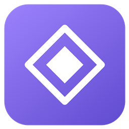
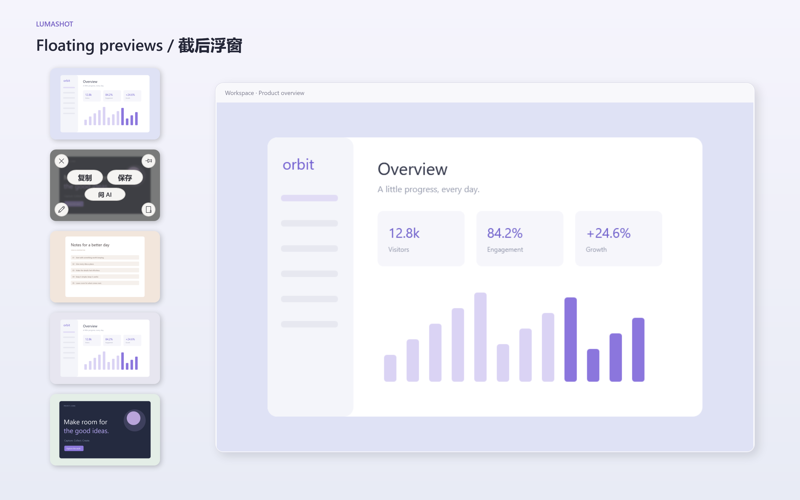
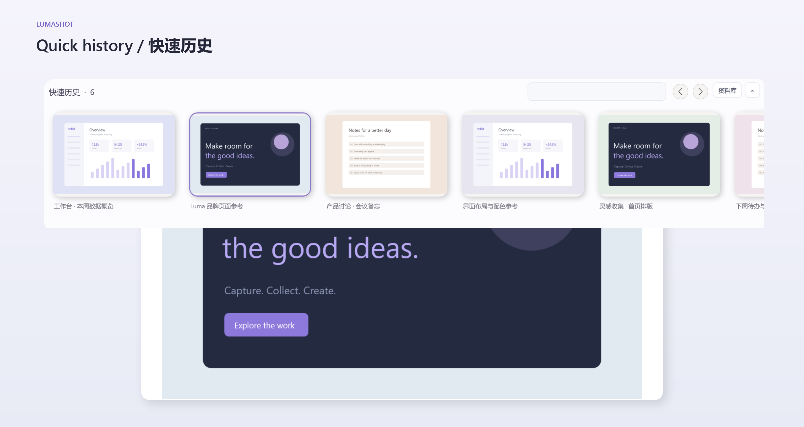
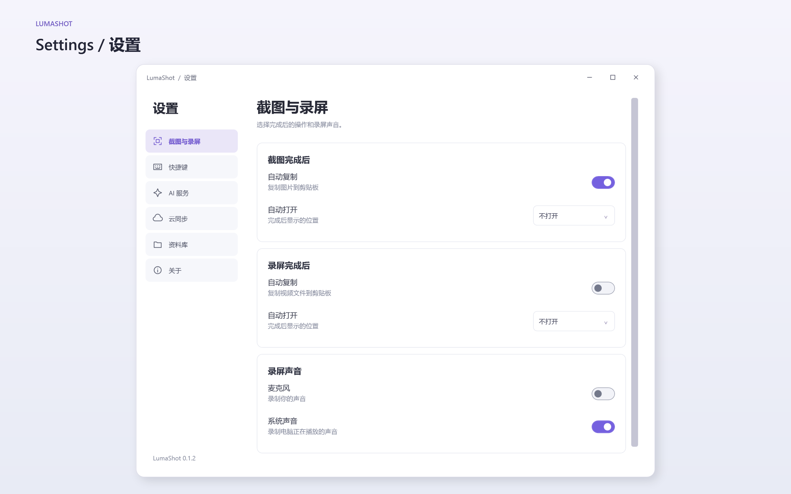
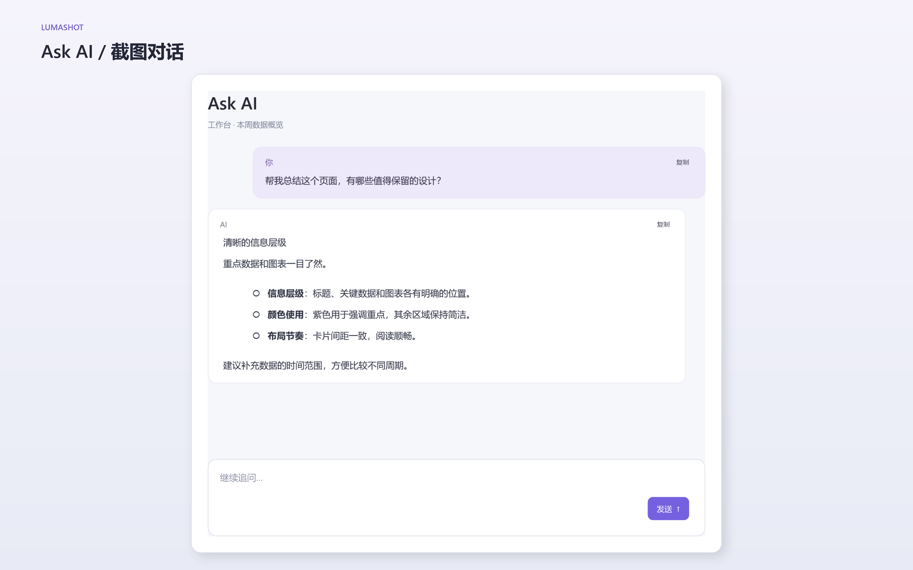

<p align="center">
  
</p>

<h1 align="center">LumaShot</h1>

<p align="center">
  <strong>A modern, local-first screenshot, screen recording, and visual knowledge workflow for Windows.</strong><br />
  Instant floating previews, built-in offline OCR, non-destructive annotation, conflict-free cloud sync, and streaming Ask AI — all in one fast desktop app.
</p>

<p align="center">
  <strong>English</strong> · <a href="README.zh-CN.md">简体中文</a>
  &nbsp;|&nbsp;
  <a href="https://github.com/glin93/LumaShot/releases/tag/v0.1.4">Download v0.1.4</a> ·
  <a href="CHANGELOG.md">Changelog</a> ·
  <a href="https://github.com/glin93/LumaShot/issues">Issues</a>
</p>


## Why LumaShot

- **Instant, Clean Capture** — A prewarmed capture engine opens the crosshair immediately with zero startup lag. Static screenshots automatically hide mouse arrows and hand cursors for crisp captures, while screen recordings preserve cursor motion. Press `Esc` at any moment to cancel cleanly.
- **Smart Floating Previews** — Recent captures stack neatly along the left edge with dark translucent quick actions: copy, annotate, ask AI, pin, or drag and drop directly into any app. Each preview auto-dismisses independently after 15 seconds and pauses while you hover, drag, or open its menu.
- **Permanent Searchable Library & Quick History** — Press `Ctrl + Shift + H` for a fast top-edge history strip or `Ctrl + Shift + L` for the full library. Built-in offline Windows OCR automatically indexes text inside every screenshot, paired with interactive tag chips, searchable notes, favorites, and reversible trash.
- **Non-Destructive Annotation & Pinning** — Every saved edit creates a new linked version so your original capture is never overwritten. Pin any screenshot above your workspace for effortless side-by-side reference.
- **Flexible Screen Recording & GIF Export** — Record a region, window, or full screen with independent toggles for system audio and microphone, plus one-click GIF conversion.
- **Ask AI on Any Screenshot or Video** — Streaming multimodal Q&A powered by your own OpenAI or Gemini API key, with automatic frame sampling for recordings and Markdown conversations saved right alongside each capture.
- **Local-First & Conflict-Free Cloud Sync** — Your captures live as plain local files with one-click ZIP backup and merge restore. Enable optional two-way sync via your own Google Drive or WebDAV (NAS / Nextcloud) with local credentials protected by Windows DPAPI.

## Interface Gallery

| Floating Previews | Quick History |
| --- | --- |
|  |  |

| Settings | Ask AI |
| --- | --- |
|  |  |

## Quick Start

1. **Capture** — Press `Ctrl + Shift + 2` to grab a region (screenshots are copied to your clipboard automatically).
2. **Act** — Copy, annotate, pin, ask AI, or drag directly out of the left-edge floating preview.
3. **Find anything later** — Press `Ctrl + Shift + H` for Quick History or `Ctrl + Shift + L` to open the full Library and search titles, tags, notes, or OCR text.

| Action | Default Shortcut |
| --- | --- |
| Region screenshot | `Ctrl + Shift + 2` |
| Window screenshot | `Ctrl + Shift + 4` |
| Full-screen screenshot | `Ctrl + Shift + 3` |
| Region recording | `Ctrl + Shift + 5` |
| Window recording | `Ctrl + Shift + 6` |
| Full-screen recording | `Ctrl + Shift + 7` |
| Quick history | `Ctrl + Shift + H` |
| Library | `Ctrl + Shift + L` |

All shortcuts can be customized in **Settings**. Closing the Library keeps LumaShot ready in the system tray; choose **Exit LumaShot** from the tray or sidebar to quit.

## Installation

Download **[LumaShot-0.1.4-Setup-x64.exe](https://github.com/glin93/LumaShot/releases/tag/v0.1.4)** from [Releases](https://github.com/glin93/LumaShot/releases). The installer bundles all required runtimes and installs cleanly for the current user on **Windows 10 (22H2+)** and **Windows 11 (x64)**.

> **Notes:** The v0.1.4 installer is currently unsigned (Windows SmartScreen may ask for confirmation on first run). ChatGPT sign-in is an optional installer component with its own noncommercial license; OpenAI and Gemini API keys work out of the box without installing it.

## Build from Source

LumaShot combines a native C# / WPF desktop UI, ShareX capture and annotation engine, FFmpeg media processing, a Node.js backend for AI and sync, and rclone for cloud storage transfers.

Run in PowerShell from the repository root to fetch checksum-pinned dependencies, install npm packages, and build:

```powershell
./bootstrap-windows.ps1
```

For subsequent incremental builds:

```powershell
./build.ps1
```

To package the installer (requires Inno Setup 7.1.1):

```powershell
./build-installer.ps1 -Compiler 'C:\path\to\Inno Setup\ISCC.exe'
```

## Documentation

- [Settings, storage, and connections](docs/USAGE.md)
- [Architecture and the future macOS boundary](ARCHITECTURE.md)
- [Validation scope](docs/VALIDATION.md)
- [Changelog](CHANGELOG.md)
- [Dependencies](THIRD_PARTY.md) and [corresponding sources](SOURCES.md)

## License

LumaShot's own code is licensed under [GPL-3.0-only](LICENSE). Third-party components retain their respective licenses. The optional [ChatGPT sign-in component](backend/siwc/LICENSE) carries a separate noncommercial license.
