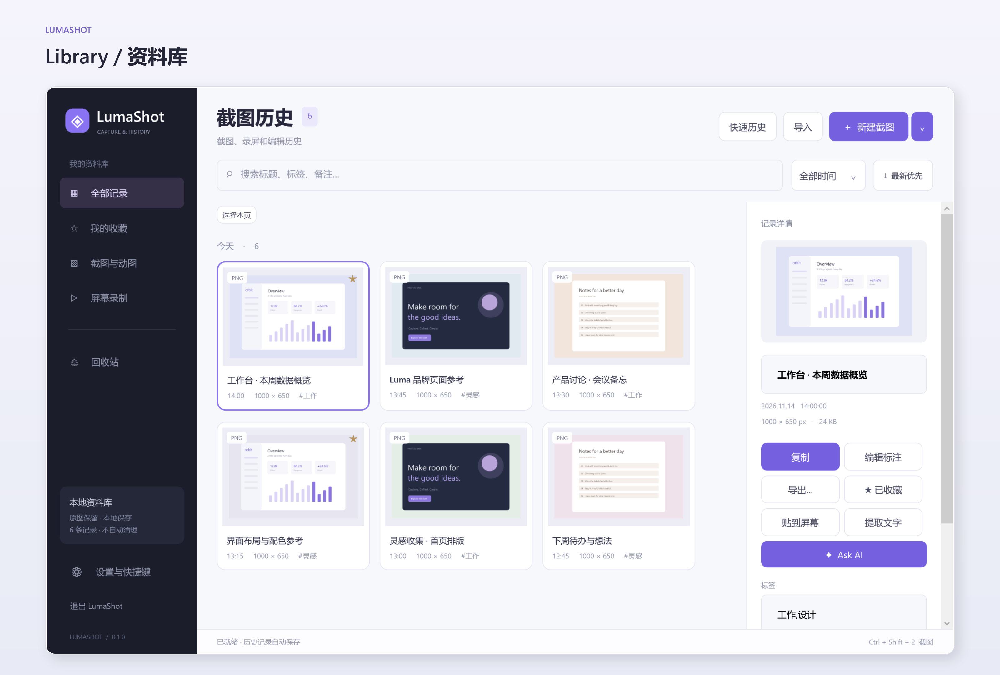

<p align="center"></p>

# LumaShot

A Windows screenshot and screen recording app with a persistent library, floating previews, annotation, cloud sync, and AI image questions.

**English** · [简体中文](README.zh-CN.md)

[Download v0.1.0](https://github.com/glin93/LumaShot/releases/tag/v0.1.0) · [Report an issue](https://github.com/glin93/LumaShot/issues)



## Features

- **Capture and record.** Capture a region, window, or full screen. Record microphone and system audio independently, with saved preferences.
- **Floating previews.** Recent captures stack along the left edge. Copy, save, annotate, pin, or dismiss a capture directly. The stack adapts to the available screen height.
- **Persistent history.** Browse a quick history panel or open the full library. Search titles, tags, notes, and OCR text; organize favorites and restore deleted items.
- **Originals preserved.** Each saved edit creates a new image linked to its original.
- **Cloud sync.** Automatically merge captures and settings through Google Drive or WebDAV. Shortcut configurations are shared by platform.
- **Ask AI.** Ask questions about screenshots or sampled video frames using OpenAI or Gemini. Save multiple connections, choose a model from the list, and keep one connection active at a time.

## Screenshots

| Floating previews | Quick history |
| --- | --- |
|  |  |

*Illustrated with sample content rendered from the app's interface.*

## Install

Download **LumaShot-0.1.0-Setup-x64.exe** from [Releases](https://github.com/glin93/LumaShot/releases). The installer includes the required runtimes and installs for the current user.

**Requirements:** Windows 10 22H2 or Windows 11, x64. The v0.1.0 installer is unsigned.

ChatGPT sign-in is an optional installer component. Selecting it opens its separate noncommercial license for acceptance. OpenAI and Gemini API keys work without this component.

## Quick start

1. Press **Ctrl + Shift + 2** to capture a region.
2. Use the floating preview to copy, save, or edit it. Images are copied automatically by default.
3. Press **Ctrl + Shift + H** for quick history, or **Ctrl + Shift + L** for the library.
4. Open **Settings** to change shortcuts, recording audio, capture actions, and connections.

Closing the library keeps LumaShot in the system tray. Choose **Exit LumaShot** to quit.

| Action | Default shortcut |
| --- | --- |
| Region screenshot | `Ctrl + Shift + 2` |
| Window screenshot | `Ctrl + Shift + 4` |
| Full-screen screenshot | `Ctrl + Shift + 3` |
| Region recording | `Ctrl + Shift + 5` |
| Window recording | `Ctrl + Shift + 6` |
| Full-screen recording | `Ctrl + Shift + 7` |
| Quick history | `Ctrl + Shift + H` |
| Library | `Ctrl + Shift + L` |

All shortcuts are configurable. Microphone recording is off by default; system audio is on. Image and video completion actions are configured separately.

## Build from source

The Windows app uses C# / WPF, ShareX for capture and annotation, FFmpeg for media processing, a Node.js backend, and rclone for cloud transfers.

Run in PowerShell from the repository root:

```powershell
./bootstrap-windows.ps1
```

This downloads checksum-pinned dependencies, installs the npm lockfile, and builds the app with the Windows .NET Framework compiler. For subsequent builds:

```powershell
./build.ps1
```

To build the installer, install Inno Setup 7.1.1 and run:

```powershell
./build-installer.ps1 -Compiler 'C:\path\to\Inno Setup\ISCC.exe'
```

## Documentation

- [Settings, storage, and connections](docs/USAGE.md)
- [Architecture and the future macOS boundary](ARCHITECTURE.md)
- [Validation scope](docs/VALIDATION.md)
- [Changelog](CHANGELOG.md)
- [Dependencies](THIRD_PARTY.md) and [corresponding sources](SOURCES.md)

## License

LumaShot's own code is licensed under [GPL-3.0-only](LICENSE). Third-party components retain their respective licenses. The optional [ChatGPT sign-in component](backend/siwc/LICENSE) has a separate noncommercial license.
