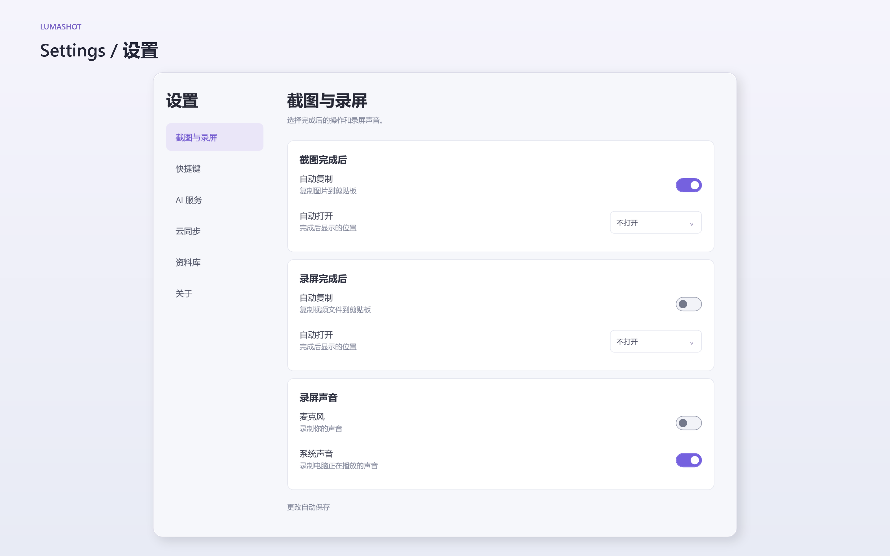
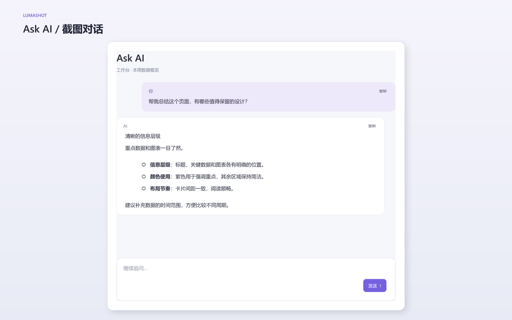

<p align="center"></p>

# LumaShot

Windows 截图与录屏工具，集成长期历史记录、截后浮窗、图像标注、云同步和 AI 图像问答。

[English](README.md) · **简体中文**

[下载 v0.1.1](https://github.com/glin93/LumaShot/releases/tag/v0.1.1) · [反馈问题](https://github.com/glin93/LumaShot/issues)


## 功能

- **截图与录屏**：支持区域、窗口和全屏；麦克风与机内声音分别设置，自动记忆。
- **截后浮窗**：截图在屏幕左侧排列，可直接复制、保存、编辑、贴图或关闭。显示数量随屏幕可用高度调整。
- **长期历史**：快速历史浮窗与完整资料库；按标题、标签、备注和 OCR 文字搜索，支持收藏与回收站。
- **保留原图**：每次保存编辑都会生成新图片，并关联原始记录。
- **云同步**：Google Drive、WebDAV 自动双向合并截图与设置，快捷键按平台同步。
- **AI 问答**：使用 OpenAI 或 Gemini 对截图、视频采样画面提问。可保存多个连接，从列表选择模型，同一时间启用一个方案。

## 界面展示

| 截后浮窗 | 快速历史 |
| --- | --- |
|  |  |

*使用应用界面与虚构内容生成的展示图。*

| 设置 | Ask AI |
| --- | --- |
|  |  |

## 安装

从 [Releases](https://github.com/glin93/LumaShot/releases) 下载 **LumaShot-0.1.1-Setup-x64.exe**。安装包包含所需运行环境，安装到当前用户目录。

**系统要求**：Windows 10 22H2 或 Windows 11，x64。v0.1.1 安装包尚未签名。

ChatGPT 登录是可选安装组件，勾选后需阅读并接受其独立的非商业许可证。不安装该组件也可使用 OpenAI、Gemini 自带 Key。

## 开始使用

1. 按 **Ctrl + Shift + 2** 进行区域截图。
2. 在截后浮窗中复制、保存或编辑。图片默认自动复制。
3. 按 **Ctrl + Shift + H** 打开快速历史，或按 **Ctrl + Shift + L** 打开资料库。
4. 在**设置**中修改快捷键、录屏音频、截图后操作和账号连接。

关闭资料库窗口后，LumaShot 会继续在系统托盘运行。需要退出时选择**退出 LumaShot**。

| 操作 | 默认快捷键 |
| --- | --- |
| 自由截图 | `Ctrl + Shift + 2` |
| 窗口截图 | `Ctrl + Shift + 4` |
| 全屏截图 | `Ctrl + Shift + 3` |
| 自由录屏 | `Ctrl + Shift + 5` |
| 窗口录屏 | `Ctrl + Shift + 6` |
| 全屏录屏 | `Ctrl + Shift + 7` |
| 快速历史 | `Ctrl + Shift + H` |
| 资料库 | `Ctrl + Shift + L` |

以上快捷键均可修改。麦克风默认关闭，机内声音默认开启；图片和视频可分别设置完成后的复制、打开资料库或文件位置等操作。

## 源码构建

Windows 界面使用 C# / WPF，截图与标注基于 ShareX，媒体处理使用 FFmpeg，Node.js 后端负责 AI 与同步逻辑，rclone 负责云端传输。

在仓库根目录使用 PowerShell 运行：

```powershell
./bootstrap-windows.ps1
```

脚本按固定版本与校验值下载依赖，按 npm lockfile 安装后端，并调用 Windows 自带的 .NET Framework 编译器构建。依赖准备完成后，可直接运行：

```powershell
./build.ps1
```

构建安装包需要 Inno Setup 7.1.1：

```powershell
./build-installer.ps1 -Compiler 'C:\path\to\Inno Setup\ISCC.exe'
```

## 文档

- [设置、存储与账号连接](docs/USAGE.md)
- [架构与 macOS 平台边界](ARCHITECTURE.md)
- [测试与验证范围](docs/VALIDATION.md)
- [版本记录](CHANGELOG.md)
- [第三方依赖](THIRD_PARTY.md)与[对应源码](SOURCES.md)

## 许可

LumaShot 自有代码采用 [GPL-3.0-only](LICENSE)。第三方组件保留各自许可证；可选的 [ChatGPT 登录组件](backend/siwc/LICENSE)采用独立的非商业许可证。
